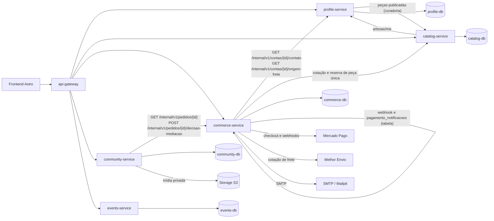

# Platform Balaio

Ambiente de desenvolvimento local do Balaio. Cada aplicação tem seu repositório e sua imagem. O Compose monta a rede, os bancos PostgreSQL e os containers que você escolher iniciar.

## Antes de começar

**Requisitos**

- Git e Docker com Compose v2 (Docker Desktop no Windows e no macOS).
- Memória: reserve pelo menos 4 GB para o Docker. Com a pilha completa no ar, os 12 containers usam cerca de 2,2 GB; o pico durante o build não foi medido.
- Portas livres no computador: 4321, 8080 a 8085 e 5433 a 5437 (todas configuráveis por `*_HOST_PORT`).
- PowerShell 7.2+ só se for usar `scripts/start-local.ps1`, que é opcional.

**Clone os repositórios lado a lado.** Os nomes das pastas importam, porque o Compose monta os caminhos como `../<pasta>`. As branches abaixo são as de integração hoje; confirme com a equipe se mudarem (o `community-service` só tem `main`).

```powershell
mkdir Repo; cd Repo
git clone -b develop https://github.com/balaio-projeto/platform.git
git clone -b develop https://github.com/balaio-projeto/api-gateway.git
git clone -b develop https://github.com/balaio-projeto/catalog-service.git
git clone -b develop https://github.com/balaio-projeto/profile-service.git
git clone -b develop https://github.com/balaio-projeto/commerce-service.git
git clone -b develop https://github.com/balaio-projeto/events-service.git
git clone https://github.com/balaio-projeto/community-service.git
git clone -b develop https://github.com/balaio-projeto/Balaio-Front.git
```

O resultado é esta estrutura (o frontend fica em `Balaio-Front/Frontend`):

```text
Repo/
├── Balaio-Front/Frontend/
├── api-gateway/
├── catalog-service/
├── profile-service/
├── commerce-service/
├── community-service/
├── events-service/
└── platform/
```

**Administrador.** Para entrar como administrador (curadoria), defina `ADMIN_EMAIL` e `ADMIN_SENHA_INICIAL` (mínimo de 12 caracteres) no `.env` **antes** da primeira subida. Sem isso a pilha funciona normalmente, só não existe conta de administrador. Contas comuns podem ser cadastradas pela tela. O admin é criado com troca de senha obrigatória; para o roteiro E2E real do frontend (`npm run test:e2e:real`), defina também `QA_ADMIN_SENHA`, a senha que o preparador de dados grava na primeira troca e usa depois (ver `Balaio-Front/Frontend/docs/qa/matriz-telas.md`).

## O que é configurado automaticamente

O `Dockerfile` de cada serviço constrói sua imagem e declara a porta interna; ele não cria banco nem publica portas no computador. O `docker-compose.yml` dá nome aos containers, conecta todos na mesma rede, publica as portas e fornece ao serviço a URL JDBC, o usuário e a senha do próprio banco. A imagem PostgreSQL cria os bancos e usuários na primeira inicialização dos respectivos volumes. O catálogo usa também seu script de inicialização para criar o banco e o usuário da aplicação.

As portas internas e os nomes usados entre containers permanecem fixos. As portas dos bancos publicadas pelo Compose escutam somente em `127.0.0.1`; outros dispositivos da rede não conseguem acessá-las diretamente. Para mudar apenas a porta acessada pelo computador local, use as variáveis `*_HOST_PORT` do `.env.example`.

## Serviços

| Aplicação | Porta HTTP | Banco e porta no computador | Inicialização padrão |
| --- | ---: | --- | --- |
| Frontend | 4321 | — | Sim |
| api-gateway | 8080 | — | Sim |
| catalog-service | 8081 | catalog-db, 5433 | Sim |
| profile-service | 8082 | profile-db, 5434 | Sim |
| commerce-service | 8083 | commerce-db, 5435 | Opcional |
| community-service | 8084 | community-db, 5436 | Opcional |
| events-service | 8085 | events-db, 5437 | Opcional |
| seaweedfs | 8333 (somente loopback) | volume seaweedfs-data | Sim (provisionado por `start-local.ps1`) |

Cada serviço de negócio usa seu próprio banco e volume. O `profile-service` e o Gateway integram a pilha padrão para testes diretos das APIs; o frontend encaminha todas as chamadas da API ao Gateway; não há mais Fake API. Os bancos dos três serviços opcionais são containers separados. O gateway recebe os endereços internos dos cinco serviços mesmo quando algum serviço opcional está parado. As rotas sem implementação no serviço de destino ainda retornarão erro.

Acesso pela máquina local: as portas HTTP dos serviços (8081 a 8085) são publicadas somente em `127.0.0.1`, para que outros dispositivos da rede não as alcancem direto. O tráfego da aplicação entra pelo frontend (4321) e pelo gateway (8080). Scripts de teste no próprio computador, como `test-gateway-commerce-integration.ps1`, continuam funcionando em `localhost`.

## Primeiro uso

Na pasta `platform`, com o Docker em execução, use o script (caminho recomendado, que sobe também o storage de mídia). O `docker compose` direto sobe a pilha sem provisionar o storage; use-o só com o `.env` já provisionado (veja [Storage de mídia](#storage-de-mídia-seaweedfs)):

```powershell
docker compose --profile extended up --build
```

```powershell
pwsh -File scripts/start-local.ps1
```

O script exige PowerShell 7.2+ e faz a mais: cria o `.env` se faltar (com senha de banco e token interno aleatórios), provisiona o storage de mídia na primeira subida, inicia o Docker Desktop se necessário, recusa iniciar se o banco do perfil tiver migrations legadas (veja [Volumes antigos do perfil](#volumes-antigos-do-perfil)), sobe os bancos primeiro e depois faz build e espera a saúde de todos os serviços. Use `-NoBuild` para reaproveitar as imagens e `-Check` para só verificar. Ele nunca remove volumes, redefine senhas, altera históricos Flyway nem atualiza código.

Em ambos, o Compose usa senhas locais demonstrativas para os bancos e um token interno local, e o `profile-service` gera o par JWT RSA num volume: o volume da chave privada é montado só nele, e os demais serviços recebem apenas a chave pública. O `.env` é opcional; as variáveis estão em `.env.example`. Não use esses defaults fora do computador de desenvolvimento. O administrador inicial só é criado se `ADMIN_EMAIL` e `ADMIN_SENHA_INICIAL` (mínimo de 12 caracteres) estiverem no `.env`; contas comuns podem ser cadastradas normalmente.

Para pagar de fato no sandbox, forneça opcionalmente `MERCADOPAGO_ENVIRONMENT=sandbox`, `MERCADOPAGO_ACCESS_TOKEN`, `MERCADOPAGO_WEBHOOK_SECRET`, `MERCADOPAGO_NOTIFICATION_URL` (HTTPS público) e `FRONTEND_RETURN_URL` (HTTPS público). Sem o conjunto completo, o commerce inicia, mas `POST /api/v1/checkout` retorna 503. Configuração parcial ou de produção é recusada. Use conta de teste vendedora e compradora distintas; veja [roteiro PI-54](../commerce-service/docs/PI-54-checkout-pro-sandbox.md). Não versione valores dessas variáveis.

## Pilha completa (perfil extended)

`docker compose --profile extended up --build` inicia frontend, gateway, perfil, catálogo, commerce, community, events e seus bancos, sem SeaweedFS. O frontend encaminha o checkout e o estado de pedidos ao Gateway. As demais telas continuam conforme sua integração atual.

O perfil e o gateway recebem `AUTH_ALLOWED_ORIGINS`, com padrão `http://localhost:4321`. Se mudar `FRONTEND_HOST_PORT`, ajuste essa origem. Para HTTP local, `AUTH_COOKIE_SECURE=false`; em HTTPS, configure `true`. A chave privada JWT local fica no volume `jwt-local-private` acessível apenas ao perfil; a chave pública é publicada no volume `jwt-local-public` para os serviços validadores. O par persiste entre reinícios do Compose.

### Volumes antigos do perfil

Se o volume do profile-service foi criado com as migrations antigas V1 ou V5/V6, o start-local.ps1 recusa iniciar e não altera nada. Siga o procedimento com backup em [docs/migracoes-legadas.md](docs/migracoes-legadas.md).

## Problemas comuns

| Sintoma | Causa e solução |
| --- | --- |
| `path ... Balaio-Front/Frontend not found` no build | O clone do frontend precisa estar em `Repo/Balaio-Front/Frontend`, ao lado de `platform`. Se estiver em outra pasta, defina `FRONTEND_CONTEXT` no `.env` com o caminho relativo a `platform`. |
| `password authentication failed` num banco | O volume já existia com outra senha; o Postgres só lê a senha na criação do volume. Use a senha original em `DB_PASSWORD` ou, se puder perder os dados, `docker compose down -v`. |
| `port is already allocated` | Outra aplicação usa a porta. Mude a variável `*_HOST_PORT` correspondente no `.env`. |
| Erro de versão ao rodar `scripts/start-local.ps1` | Use `pwsh` (PowerShell 7.2+), não `powershell.exe`. |
| Frontend não sobe | Ele espera o gateway ficar saudável, que por sua vez espera catálogo e perfil. Veja `docker compose logs api-gateway profile-service`. |

## Comandos úteis

```powershell
docker compose ps
docker compose logs -f api-gateway catalog-service
docker compose down
```

Para testar o Gateway e o commerce de ponta a ponta num ambiente descartável: `./scripts/test-gateway-commerce-integration.ps1 -GatewayBase http://localhost:8080 -CommerceBase http://localhost:8083`. Ele lê o token interno e o administrador do `.env` e cria contas, peças e pedidos de teste; não use em ambiente com dados reais.

`docker compose down` preserva os volumes. Os vídeos e capas enviados ao community ficam no volume `community-midia`. `docker compose down -v` apaga os bancos locais e esse volume; use esse comando somente se quiser perder esses dados. As portas HTTP e dos bancos no computador são configuráveis por `*_HOST_PORT` no `.env`; as portas publicadas dos bancos permanecem restritas a `127.0.0.1`, e dentro da rede do Compose as portas internas continuam as mesmas.

Para executar um serviço pela IDE, use a URL JDBC com `localhost` e a porta do banco na tabela acima, além do usuário e da senha configurada para aquele banco. Para executar dentro do Compose, as URLs JDBC e o endereço de cada serviço são configurados automaticamente pelos nomes dos containers. O Spring Boot não lê `.env` sozinho fora do Compose.

## Estado da integração

O frontend fala apenas com o Gateway, e todas as telas atuais têm endpoint: catálogo; perfil (autenticação, recuperação de senha, perfil público, conta, endereços, coletivos, configurações do ateliê e selo/curadoria); commerce (sacola, checkout e pedidos); community (perguntas, vídeos, conversas, avaliações, coleções e mediação); events (listagem, detalhe e criação). Recomendações por IA e indicadores administrativos ficam para depois.

### SMTP da recuperação de senha

O provedor é escolhido no `.env` por `PROFILE_SMTP_*` e `PROFILE_MAIL_FROM`; o `.env.example` traz os padrões locais e um exemplo para Gmail (senha de app, não a senha da conta). `PROFILE_FRONTEND_BASE_URL` precisa ser HTTPS e acessível em homologação; `http://localhost:4321` só serve no mesmo computador. Mudanças de `.env` não chegam a um container em execução: recrie só o perfil com `docker compose up -d --no-deps --build --wait profile-service`. Regras de validação e testes isolados estão no [README do Profile](../profile-service/README.md#pi-170--smtp-por-ambiente-e-validação-ponta-a-ponta).

## Storage de mídia (SeaweedFS)

O SeaweedFS (S3 das imagens de perfil) fica em `docker-compose.storage.yml`, no perfil `storage`, e faz parte da pilha padrão. Na primeira subida, `scripts/start-local.ps1` roda [storage/scripts/prepare-local-storage.ps1](storage/scripts/prepare-local-storage.ps1), que gera credenciais e certificados locais e acrescenta as variáveis `MEDIA_S3_*` ao `.env`. Nas subidas seguintes, ele só reaproveita o que já existe. O `docker compose` direto não faz esse provisionamento. Detalhes, testes e backup estão em [storage/](storage/README.md).

## Dados de demonstração e reset

- **Dados de demonstração:** o catálogo vem com peças de exemplo pela migração `V2` do `catalog-service`. Ela entra apenas em volumes novos. Artesãos, compradores e pedidos não são criados automaticamente: cadastre-os pela tela ou pela API. O administrador existe só se `ADMIN_EMAIL` e `ADMIN_SENHA_INICIAL` estiverem no `.env` antes da primeira subida.
- **Reset completo (apaga dados):** `docker compose -f docker-compose.yml -f docker-compose.storage.yml --profile extended --profile storage down -v`. Remove os bancos, as fotos de storage, os vídeos da comunidade e as chaves JWT locais, que são geradas de novo na próxima subida. Não apaga o `.env` nem a pasta `secrets/`.
- **Reset só dos dados de mídia:** remova apenas os volumes `seaweedfs-data` e `community-midia` com `docker volume rm` (os nomes têm o prefixo do projeto, por exemplo `balaio-local_seaweedfs-data`), depois suba a pilha de novo.

---

## Arquitetura distribuída e benchmark (Parte 2)

### Serviços e por que cada um existe

| Serviço | Responsabilidade | Por que é separado | Banco próprio |
| --- | --- | --- | --- |
| api-gateway | Ponto único de entrada, validação de JWT, CORS e matriz de rotas | Concentra a política de acesso fora dos domínios | não |
| profile-service | Identidade, emissão do JWT RS256 e dados de conta | Ciclo de vida e segurança de identidade próprios | sim |
| catalog-service | Vitrine (leitura pesada) e reserva atômica de peça única | Leitura intensa e consistência de estoque independentes | sim |
| commerce-service | Pedido, pagamento, frete e e-mails | Integrações externas instáveis (Mercado Pago, Melhor Envio, SMTP) e filas próprias | sim |
| community-service | Mediação, avaliações e vídeos | Ritmo de mudança independente e armazenamento de mídia | sim |
| events-service | Moderação e agenda de eventos | Domínio isolado do comércio | sim |

Nem tudo precisa ser serviço separado: o catálogo e o perfil já justificam a separação pelo ciclo de vida e pela carga; os demais seguem a mesma regra e só se separam onde há fronteira clara.

### Diagrama da arquitetura



As chamadas internas usam `/internal/v1/**`, protegidas pelo cabeçalho `X-Balaio-Service-Token`. A fila de e-mails e a de webhooks são tabelas no PostgreSQL, processadas por workers agendados.

### Trecho paralelo

- **Arquivo:** `commerce-service/src/main/java/br/com/balaio/commerce/notification/application/EmailPedidoService.java`
- **Escolha do modo:** linha 67 (`paralelo ? enviarEmParalelo(lote) : enviarEmSequencia(lote)`)
- **Sequencial:** linhas 71 a 79
- **Paralelo:** linhas 81 a 97, com threads virtuais (`Executors.newVirtualThreadPerTaskExecutor`) e `Semaphore` limitando a concorrência
- **Falha por item:** `enviarItem`, linhas 99 em diante; uma falha registra a tentativa e não derruba o lote
- **Configuração:** `balaio.mail.paralelo` (padrão `false`), `balaio.mail.concorrencia` (padrão 8), `balaio.mail.max-lotes-por-ciclo` (padrão 20)

Testes: `EmailPedidoServiceTest` (fila em memória, sem Docker) e `PosVendaHttpPostgresTest` (PostgreSQL real, com `COMMERCE_POSTGRES_TEST=true`), rodados nos dois modos.

### Metodologia do benchmark

- **O que foi medido:** tempo para esvaziar a fila de e-mails (s) e vazão (e-mails/s), nos modos sequencial e paralelo.
- **Como foi medido:** `platform/scripts/benchmark-email/medir-drenagem.ps1`. Ele semeia N pedidos com um e-mail pendente cada, sobe o commerce-service com as propriedades do cenário e mede o intervalo entre o primeiro e o último `enviado_em`. Também confere falhas e o total de mensagens no Mailpit.
- **Matriz:** `platform/scripts/benchmark-email/matriz.ps1`, com 6 cenários e 5 repetições cada.
- **Latência injetada:** Toxiproxy aplica latência por resposta SMTP (um envio tem várias respostas). Sem latência, o Mailpit responde em milissegundos e o ganho não é interpretável.
- **Propriedades fixadas:** `mail.smtp.localhost` e `mail.from`, para evitar a consulta DNS reversa do JavaMail a cada envio neste host; `max-lotes-por-ciclo` alto, para drenar a fila inteira em cada ciclo.
- **Ambiente:** `platform/docs/benchmark/ambiente.md`.
- **Dados brutos:** `platform/docs/benchmark/resultados-email.csv`.

### Resultados

Média e desvio padrão de 5 repetições por cenário, com 0 falhas e o total de mensagens no Mailpit igual ao volume em todas as execuções (30 execuções, `resultados-email.csv`).

| Volume | Latência por resposta SMTP | Modo | Tempo médio (s) | Desvio padrão (s) | Vazão média (e-mails/s) | Ganho |
| ---: | ---: | --- | ---: | ---: | ---: | ---: |
| 1.000 | 0 ms | sequencial | 12,68 | 0,42 | 79,0 ± 2,6 | — |
| 1.000 | 0 ms | paralelo (concorrência 8) | 2,83 | 0,12 | 353,6 ± 15,9 | 4,5× |
| 1.000 | 20 ms | sequencial | 159,85 | 2,01 | 6,3 ± 0,1 | — |
| 1.000 | 20 ms | paralelo (concorrência 8) | 24,94 | 0,22 | 40,1 ± 0,4 | 6,4× |
| 200 | 100 ms | sequencial | 143,70 | 0,10 | 1,4 ± 0,0 | — |
| 200 | 100 ms | paralelo (concorrência 8) | 21,19 | 0,07 | 9,4 ± 0,0 | 6,8× |

### Interpretação

- **Onde houve ganho:** com latência de SMTP, o paralelismo acelerou o envio em 6,4× (20 ms) e 6,8× (100 ms), com concorrência 8. O limite teórico é 8×: a parte que não se sobrepõe (a linha de envio e a consulta ao profile, que roda dentro de cada item) ainda é sequencial dentro de cada thread.
- **Por que a latência domina:** o tempo sequencial segue `e-mails × respostas SMTP × latência`. Com 1.000 e-mails a 20 ms, o tempo esperado é cerca de 160 s (8 respostas por envio), e o medido é 159,85 s. Com 200 e-mails a 100 ms, o esperado é cerca de 140 s (7 respostas) e o medido é 143,7 s.
- **Controle em 0 ms:** o ganho não desapareceu, caiu para 4,5×. Eu esperava um ganho pequeno, mas não nulo, porque mesmo sem latência de rede cada envio tem trabalho bloqueante (duas consultas ao banco, uma chamada HTTP ao profile e a conexão SMTP) que se sobrepõe entre as threads. Esse número é o limite inferior do ganho em ambiente local.
- **Concorrência acima do pool do Hikari (padrão de 10 conexões):** medida em 1.000 e-mails com latência de 20 ms, 5 repetições por concorrência (`platform/docs/benchmark/resultados-email-concorrencia.csv`). Com concorrência 4, o tempo foi 40,5 ± 0,4 s; com 8, 24,7 ± 0,0 s; com 16, 16,8 ± 0,2 s (vazão de 59,5 req/s, contra 40,4 com 8). Ou seja, com 16 envios simultâneos, acima do pool, o ganho continua, e não há sinal de saturação do pool.
- **Concorrência 32:** 8,77 ± 0,09 s e vazão de 114,0 ± 1,2 req/s, com 5 repetições. Esse resultado só foi obtido com aquecimento: a primeira execução sem aquecimento travou sem drenar a fila. O thread dump mostrou threads virtuais presas no `synchronized` do carregador de classes do Spring Boot (`JarUrlClassLoader`), com as oito carriers bloqueadas. Nenhuma espera por conexão do Hikari apareceu, então o problema não é o pool, e sim o carregamento de classes sob concorrência no primeiro uso do código. Com aquecimento de 200 e-mails na mesma JVM, a execução concluiu normalmente.
- **Resumo da concorrência (1.000 e-mails, 20 ms):** 4 → 40,5 s; 8 → 24,7 s; 16 → 16,8 s; 32 → 8,8 s. O ganho continua acima das 10 conexões do pool, e não há sinal de saturação do pool neste intervalo. Como o aquecimento foi necessário só para 32, vale notar que a medição de 32 é a única que depende de metodologia adicional.

### Vitrine: carga concorrente (HTTP)

Metodologia: `GET /api/v1/pecas?tamanho=12` no catalog-service (porta direta, sem gateway), com 21.030 peças (18.927 públicas). Carga com k6 (`grafana/k6`, via Docker) e usuários virtuais constantes. Cada nível tem 10 s de aquecimento descartados e 5 repetições de 30 s. Vazão = requisições ÷ 30 s. Dados brutos em `platform/docs/benchmark/http/resultados-vitrine.csv`; scripts em `platform/scripts/benchmark-http/`.

| Usuários virtuais | Vazão (req/s) | p50 (ms) | p95 (ms) | p99 (ms) |
| ---: | ---: | ---: | ---: | ---: |
| 1 | 51,7 ± 2,0 | 18,7 ± 0,7 | 23,4 ± 1,6 | 27,8 ± 2,1 |
| 10 | 402,1 ± 10,0 | 23,9 ± 0,7 | 30,7 ± 2,2 | 38,6 ± 5,5 |
| 50 | 391,3 ± 29,3 | 122,4 ± 10,8 | 166,8 ± 17,9 | 213,5 ± 19,7 |

Média ± desvio padrão de 5 repetições. Interpretação:

- De 1 para 10 usuários, a vazão sobe quase 8× e a latência praticamente não muda: a vitrine escala bem enquanto há CPU disponível.
- De 10 para 50 usuários, a vazão fica estável (cerca de 390 a 400 req/s) e a latência p50 sobe 5×. O sistema saturou.
- O ponto de saturação não é só do catálogo: o k6, a JVM do catálogo e o PostgreSQL dividem os mesmos 8 núcleos físicos da máquina. Não é possível separar o limite do serviço do limite do gerador de carga neste ambiente.
- A medição com o k6 da própria janela de 30 s teve uma repetição com a duração inflada (uma pausa no encerramento). Por isso a vazão é calculada como requisições ÷ 30 s, e não pela taxa reportada pelo k6.

### Painel do artesão: sequencial x paralelo

Metodologia: `GET /api/v1/artesao/painel/resumo` no commerce-service, com o catálogo respondendo 200 peças do artesão (cerca de 115 KB). A latência é injetada na resposta do catálogo pelo Toxiproxy. Os dois modos são o mesmo código, com `balaio.painel.paralelo=false` (sequencial) ou `true` (paralelo, padrão). Medição com `curl` (tempo total do cliente): 5 chamadas de aquecimento e 30 cronometradas por repetição, 5 repetições. Dados brutos em `platform/docs/benchmark/painel/resultados-painel.csv`; script em `platform/scripts/benchmark-painel/`.

| Latência do catálogo | Sequencial (ms) | Paralelo (ms) | Diferença (ms) |
| ---: | ---: | ---: | ---: |
| 0 ms | 138,7 ± 2,7 | 138,5 ± 1,0 | 0,1 |
| 100 ms | 237,2 ± 1,6 | 236,1 ± 2,0 | 1,1 |
| 300 ms | 436,8 ± 2,7 | 436,5 ± 1,3 | 0,3 |

Média ± desvio padrão de 5 repetições. Interpretação:

- Nos dois modos, o tempo cresce exatamente com a latência injetada (cerca de 138 ms + latência). Isso confirma que a chamada ao catálogo domina o tempo do painel.
- A diferença entre os modos (no máximo 1,1 ms) fica dentro do desvio padrão. O modo paralelo só esconde o trabalho das consultas locais do painel, e esse trabalho é de poucos milissegundos.
- Portanto, neste caso o paralelismo não traz ganho mensurável. É o resultado esperado quando uma das partes é desprezível, e ele mostra onde o paralelismo não ajuda, como pede o item 3.2.
- Os 138 ms com latência zero são o custo do próprio catálogo, do JSON de 115 KB e da chamada HTTP local. Esse custo não foi decomposto nesta medição.

### Riscos e limitações

- **Chamadas síncronas** entre serviços (acoplamento temporal): se o profile-service cair, o envio de e-mail falha e é reenviado depois.
- **Entrega at-least-once:** o e-mail é marcado como enviado depois do SMTP. Uma queda entre os dois pode gerar reenvio.
- **Tabelas de fila** crescem com o tempo e precisam de limpeza.
- **Múltiplas réplicas do worker** não foram testadas; o `FOR UPDATE SKIP LOCKED` evita processamento duplicado, mas não há teste de carga com várias réplicas.
- **SMTP simulado:** o benchmark usa Mailpit com latência artificial, não um provedor real.
- **Ambiente único:** cliente, serviços, banco e SMTP rodam na mesma máquina, com disputa de CPU e de rede local.
- **Consulta DNS reversa do JavaMail:** neste host ela custava vários segundos por envio. As propriedades fixadas removem esse custo; sem elas, o ganho do paralelismo seria medido sobre uma espera de DNS, não de SMTP.

### Evidência de funcionamento

*A preencher (item 3.4 do plano): logs das chamadas entre serviços e a fila sendo drenada.*
